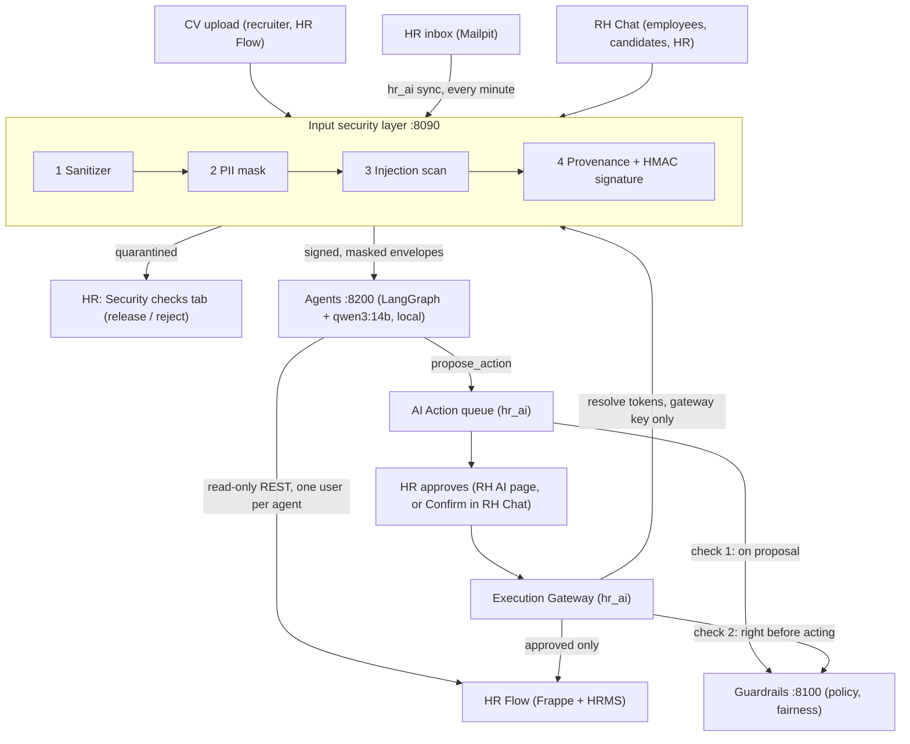

# HR Flow — Secure AI HR System

AI agents for the **HR / recruitment team**: screen and rank resumes, triage the HR inbox, draft replies,
propose interview slots. They are built on top of an open-source HR platform (Frappe v16 + ERPNext + HRMS,
branded **HR Flow**), which stays the system of record. Our code lives in our own app (`hr_ai`) and in
separate services. Upstream platform code is never patched: the exact Frappe HR source we build on is
included in [`hrms/`](hrms/) (v16.53.0, GPL v3) and the whole platform setup in [`platform/`](platform/).

**Golden rule: the agent executes, the human decides about people.** Agents only read and propose.
Nothing is sent or recorded until a human approves it.

Hackathon project (Astropreneur 2.0, SUP'COM, ~17 h). **Fictional data only.**

> **Jury: start with [`JURY_GUIDE.md`](JURY_GUIDE.md)**: install, logins, feature tour, tests.
> What is not done, simplified or assumed: [`LIMITATIONS.md`](LIMITATIONS.md).

---

## Architecture



Request path in one sentence: untrusted content is sanitized, masked, scanned and signed **before** any agent
sees it; agents can only read and propose; a deterministic policy/fairness service checks every proposal;
a human approves; only the Execution Gateway writes, after re-checking everything.

### Trust boundaries

| Boundary | Enforced by |
|---|---|
| Hostile files / emails → AI | Input security layer: magic-byte type check, sandboxed extraction, hidden-text removal, PII masking, injection scan, signed envelope |
| AI → business data | Agents hold read-only credentials (PUT/POST/DELETE return 403); their only output is a **Proposed** AI Action |
| Proposal → execution | Guardrails service (default-deny policy, fairness) + human approval bound to the action hash |
| Execution → HR Core | Execution Gateway is the only writer; re-checks hash, token and guardrails; idempotent; fails closed |

---

## Components

| Folder | What it is | Runs | Port |
|---|---|---|---|
| [`platform/`](platform/) | HR Flow platform: Frappe v16 + ERPNext + HRMS in Docker, Mailpit, image build (`build-images.sh`), fictional company **Bara3am** and its loader (`Data_set/`) | Docker Compose (project `hr`) | 8001, 8025 |
| [`hrms/`](hrms/) | Frappe HR source, v16.53.0 (GPL v3): the version built into the image | in the platform image | — |
| [`hr_ai/`](hr_ai/) | Our Frappe app: AI Action queue, **RH AI** decision page, **RH Chat**, Inbound Email, Execution Gateway, bridges to the services | in the platform image | 8001 |
| [`hrflow_theme/`](hrflow_theme/) | Our Frappe app: HR Flow look (Desk, login, website) | in the platform image | — |
| [`input-security-layer/`](input-security-layer/) | Untrusted Input Zone: sanitizer, PII masking (Presidio EN + FR), injection scanner, provenance + signature, evidence store, inspection reports | FastAPI, Docker (non-root, read-only FS) | 8090 |
| [`guardrails/`](guardrails/) | Policy Engine (default-deny), fairness checks, approval tokens, gateway logic, hash-chained audit log, monitor | FastAPI, Docker (non-root, read-only FS) | 8100 |
| [`agents/`](agents/) | LangGraph agents (Orchestrator, 8 specialists, chat operator), qwen3:14b via Ollama, read-only tools, deterministic Output Validator, signed chat/webhook service | Python 3.12 | 8200 |
| [`scripts/`](scripts/) | `setup_stack.py`: creates every key and configures the site in two commands | Python | — |
| [`tests/`](tests/) | Cross-layer guardrail tests (injection, bypass, disparity, PII, duplicate webhook, chat) | pytest | — |
| [`docs/`](docs/) | [Agents](docs/agents.md), [manual end-to-end test](docs/manual-test.md), [demo script](docs/demo-script.md) | — | — |
| [`Test scenarios/`](Test%20scenarios/) | 12 end-to-end scenarios (story + HTTP script with PASS / FAIL checks) run on the live stack | Python | — |

Demo agents: **Recruitment** (ranking, status, interviews), **Comms** (inbox digest, replies), **HR Assistant**
(policy and own-data Q&A in RH Chat), **Operator** (HR orders typed in RH Chat), **Leave** (leave decisions). Onboarding, Payroll, Performance and Conflict exist as minimal stubs and are **denied by
the policy engine** by default.

---

## Security features (what the jury can check)

**Input security layer** (`input-security-layer/`)
- Real file type from magic bytes (PDF, DOCX only); size, page, zip-entry, zip-ratio limits; macros rejected.
- Text extracted in a child process with a timeout (plus memory/CPU limits on Linux): a malicious file can only kill the child.
- Hidden text removed and **counted as a signal**: white text, tiny fonts, off-page text, DOCX hidden runs, `display:none`.
- Unicode NFKC, zero-width and bidi control characters stripped; links defanged and never fetched.
- PII: names, emails, phones (incl. +216), CIN → document-scoped tokens (`<PERSON_1>`). Age, birth date, gender,
  marital status, nationality, religion, photo → `[REMOVED]`.
- Injection scanner (FR + EN rules + structural signals) → `clean` / `suspicious` (spans neutralized) / `quarantined`
  (nothing reaches the AI; HR reviews). Any instruction hidden in invisible text is quarantined.
- Envelope signed with HMAC-SHA256 over canonical JSON; `doc_id` and every `chunk_id` are SHA-256 hashes that the agents recompute.
- Evidence store: write-once, paths only from hashes (never from the uploaded filename), raw bytes re-hashed on read, files 0600.
- Four separate API keys (upload / report / envelope / resolver); token resolution only with the gateway key.

**Agents** (`agents/`)
- Read-only Frappe user per agent; tool allowlist per agent; step, token and proposal budgets.
- Untrusted content wrapped as data, never in the system prompt; one candidate per model call; scores computed by code.
- Deterministic Output Validator: schema, cited source hashes, evidence quotes must exist in the source, no unmasked contact data.

**Guardrails + Execution Gateway** (`guardrails/`, `hr_ai/`)
- Default-deny policy: agent registered, tool on its allowlist, recipients must be Frappe **records** (a raw
  `attacker@evil.com` cannot be expressed), rate limits.
- Fairness: no protected attribute or term in payloads or justifications (EN + FR), scores must be job-related and sourced, four-fifths disparity test.
- Approval token = HMAC over (action, action hash, approver). Any edit changes the hash and voids the approval.
- Gateway re-checks hash, token and guardrails right before acting; already-executed actions are a no-op; guardrails unreachable = refused (fail closed).
- Pseudonyms are resolved to real values **only** in the gateway, after approval.
- Test mode: every outgoing email goes to `hr_ai_test_recipient`, never to a (fictional) candidate.
- Guardrails audit log: append-only (SQLite triggers) and hash-chained; `verify_chain()` finds tampering. The agents keep their own hash-chained trail (`rhf audit-verify`).

---

## Running it

Step by step, from a clean clone: **[`JURY_GUIDE.md`](JURY_GUIDE.md)**. In short (WSL / Linux, from the repo root):

```bash
bash platform/build-images.sh                                   # the image named in hr.yml (~15 min)
docker compose -p hr -f platform/hr.yml up -d                   # HR Flow on :8001 + Mailpit on :8025
#   -> setup wizard (company Bara3am), then load the fictional data:
ADMIN_PASSWORD=admin docker compose -p hr -f platform/hr.yml -f platform/Data_set/seed.yml run --rm --build seed
python3 scripts/setup_stack.py env && python3 scripts/setup_stack.py site     # keys + site configuration
docker compose -f input-security-layer/compose.ingest.yml up -d --build      # :8090
docker compose -f guardrails/compose.guardrails.yml up -d --build            # :8100
P=$HOME/.venvs/rhflow-agents/bin/python                                     # uv sync, see the guide
ADMIN_PASSWORD=admin $P agents/scripts/setup_agent_users.py                  # read-only agent users
$P -m agents.integration.server                                              # :8200 (Ollama runs qwen3:14b)
```

Secrets live only in `.env` files and the Frappe site config (`bench set-config`), all gitignored. The repository
only holds `.env.example` / `example.env` with variable names.

---

## Tests

| Suite | Command | Result (2026-11-01) |
|---|---|---|
| Agents + cross-layer | `uv run pytest -q tests` (repo root) | 67 passed |
| Guardrails | `cd guardrails && venv/bin/python -m pytest -q` | 362 passed |
| Input security layer | `cd input-security-layer && .venv/bin/python -m pytest -q` | 367 passed |

**796 passed**, all offline: a scripted fake LLM stands in for qwen and a fake Frappe stands in for HR Flow where
needed. Environment setup: [`JURY_GUIDE.md` Part A](JURY_GUIDE.md#part-a--automated-tests-no-platform-needed-5-min).
The guardrails also ship a self-contained demo: `cd guardrails && venv/bin/python scripts/demo.py --start --step`.

End-to-end scenarios on the live stack: `bash "Test scenarios/scripts/run_all.sh" fast` (6 scenarios without the
model, ~3 min) or without `fast` (all 12, ~30 min). Last full run 2026-11-01: 12/12 green.

---

## Contracts

- Ingest envelope (schema `1.1`): `input-security-layer/ingest/contract.py`; API guide: [`input-security-layer/INTEGRATION.md`](input-security-layer/INTEGRATION.md).
- Guardrails API and rule codes: [`guardrails/INTEGRATION.md`](guardrails/INTEGRATION.md).
- Agents, tools and budgets: [`docs/agents.md`](docs/agents.md).

## Team

| Area | Folder |
|---|---|
| Input security layer (Untrusted Input Zone) | `input-security-layer/` |
| Guardrails & execution control | `guardrails/` |
| Agents, `hr_ai` app, HR Flow integration | `agents/`, `hr_ai/` |
| Platform, interface / theme, test data and demo scenarios | `platform/`, `hrflow_theme/`, `Test scenarios/` |
