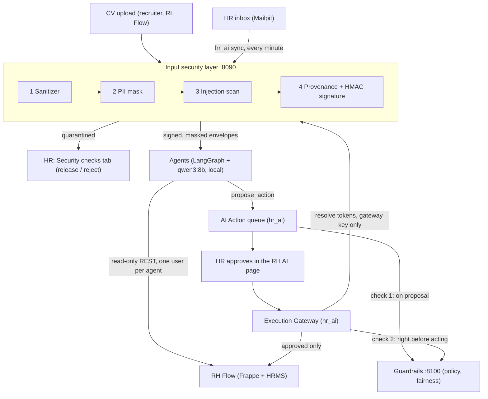

# RH Flow — Secure AI HR System

AI agents for the **HR / recruitment team**: screen and rank resumes, triage the HR inbox, draft replies,
propose interview slots. They are built on top of an open-source HR platform (Frappe v16 + ERPNext + HRMS,
branded **RH Flow**), which stays the system of record. Our code lives in our own app (`hr_ai`) and in
separate services. Upstream platform code is never patched.

**Golden rule: the agent executes, the human decides about people.** Agents only read and propose.
Nothing is sent or recorded until a human approves it.

Hackathon project (Astropreneur 2.0, SUP'COM, ~17 h). **Fictional data only.**

> What is not done, simplified or assumed: [`LIMITATIONS.md`](LIMITATIONS.md).

---

## Architecture



Request path in one sentence: untrusted content is sanitized, masked, scanned and signed **before** any agent
sees it; agents can only read and propose; a deterministic policy/fairness service checks every proposal;
a human approves; only the Execution Gateway writes, after re-checking everything.

### Trust boundaries

| Boundary | Enforced by |
|---|---|
| Hostile files / emails → AI | Input security layer: magic-byte type check, sandboxed extraction, hidden-text removal, PII masking, injection scan, signed envelope |
| AI → business data | Agents hold read-only credentials (PUT/POST/DELETE return 403); their only output is a **Proposed** AI Action |
| Proposal → execution | Guardrails service (default-deny policy, fairness) + human approval bound to the action hash |
| Execution → HR Core | Execution Gateway is the only writer; re-checks hash, token and guardrails; idempotent; fails closed |

---

## Components

| Folder | What it is | Runs | Port |
|---|---|---|---|
| [`input-security-layer/`](input-security-layer/) | Untrusted Input Zone: sanitizer, PII masking (Presidio EN + FR), injection scanner, provenance + signature, evidence store, inspection reports | FastAPI, Docker (non-root, read-only FS) | 8090 |
| [`guardrails/`](guardrails/) | Policy Engine (default-deny), fairness checks, approval tokens, gateway logic, hash-chained audit log, monitor | FastAPI, Python 3.11 | 8100 |
| [`hr_ai/`](hr_ai/) | Frappe app inside RH Flow: AI Action queue, **RH AI** decision page, Inbound Email, Execution Gateway, bridges to the two services | In-process in Frappe | 8001 |
| [`agents/`](agents/) | 9 LangGraph agents (Orchestrator + 8 specialists), qwen3:8b via Ollama, read-only tools, deterministic Output Validator | Python 3.12 (WSL) | — |
| [`tests/`](tests/) | Cross-layer guardrail tests (injection, bypass, disparity, PII, input layer) | pytest | — |
| [`docs/`](docs/) | Architecture, agents, security, contracts, [manual end-to-end test](docs/manual-test.md), [demo script](docs/demo-script.md) | — | — |
| [`Test scenarios/`](Test%20scenarios/) | 12 end-to-end scenarios (story + HTTP script with PASS / FAIL checks) run on the live stack | Python, WSL | — |

Demo agents: **Recruitment** (ranking, status, interviews), **Comms** (inbox digest, replies), **HR Assistant**
(policy Q&A). Leave, Onboarding, Payroll, Performance and Conflict exist as minimal stubs and are **denied by
the policy engine** by default.

---

## Security features (what the jury can check)

**Input security layer** (`input-security-layer/`)
- Real file type from magic bytes (PDF, DOCX only); size, page, zip-entry, zip-ratio limits; macros rejected.
- Text extracted in a child process with a timeout (plus memory/CPU limits on Linux): a malicious file can only kill the child.
- Hidden text removed and **counted as a signal**: white text, tiny fonts, off-page text, DOCX hidden runs, `display:none`.
- Unicode NFKC, zero-width and bidi control characters stripped; links defanged and never fetched.
- PII: names, emails, phones (incl. +216), CIN → document-scoped tokens (`<PERSON_1>`). Age, birth date, gender,
  marital status, nationality, religion, photo → `[REMOVED]`.
- Injection scanner (FR + EN rules + structural signals) → `clean` / `suspicious` (spans neutralized) / `quarantined`
  (nothing reaches the AI; HR reviews). Any instruction hidden in invisible text is quarantined.
- Envelope signed with HMAC-SHA256 over canonical JSON; `doc_id` and every `chunk_id` are SHA-256 hashes that the agents recompute.
- Evidence store: write-once, paths only from hashes (never from the uploaded filename), raw bytes re-hashed on read, files 0600.
- Four separate API keys (upload / report / envelope / resolver); token resolution only with the gateway key.

**Agents** (`agents/`)
- Read-only Frappe user per agent; tool allowlist per agent; step, token and proposal budgets.
- Untrusted content wrapped as data, never in the system prompt; one candidate per model call; scores computed by code.
- Deterministic Output Validator: schema, cited source hashes, evidence quotes must exist in the source, no unmasked contact data.

**Guardrails + Execution Gateway** (`guardrails/`, `hr_ai/`)
- Default-deny policy: agent registered, tool on its allowlist, recipients must be Frappe **records** (a raw
  `attacker@evil.com` cannot be expressed), rate limits.
- Fairness: no protected attribute or term in payloads or justifications (EN + FR), scores must be job-related and sourced, four-fifths disparity test.
- Approval token = HMAC over (action, action hash, approver). Any edit changes the hash and voids the approval.
- Gateway re-checks hash, token and guardrails right before acting; already-executed actions are a no-op; guardrails unreachable = refused (fail closed).
- Pseudonyms are resolved to real values **only** in the gateway, after approval.
- Test mode: every outgoing email goes to `hr_ai_test_recipient`, never to a (fictional) candidate.
- Guardrails audit log: append-only (SQLite triggers) and hash-chained; `verify_chain()` finds tampering. The agents keep their own hash-chained trail (`rhf audit-verify`).

---

## Running it

Full step-by-step walkthrough (inbox → agent → approval → email sent, plus the attack being quarantined):
**[`docs/manual-test.md`](docs/manual-test.md)**.

Prerequisites
- Docker (on Windows via WSL2) with the Frappe stack: compose project `hr`, site `frontend`, network `hr_frappe_network`, RH Flow on http://localhost:8001.
- `hr_ai` installed on the site.
- Mailpit (test mail server, http://localhost:8025).
- Ollama with `qwen3:8b` (http://localhost:11434).

Start the services

```bash
# 1. Input security layer (needs input-security-layer/.env, see .env.example)
docker compose -f input-security-layer/compose.ingest.yml up -d --build

# 2. Guardrails (needs guardrails/.env, see example.env)
cd guardrails && ./venv/Scripts/python -m uvicorn guardrails.settings:create_app_from_env --factory --host 0.0.0.0 --port 8100

# 3. Agents (WSL; needs .env, see .env.example; per-agent users from agents/scripts/setup_agent_users.py)
P=$HOME/.venvs/rhflow-agents/bin/python
$P -m agents.scripts.demo_scenario --reset          # 3 fictional emails, one is an attack
$P -m agents.cli run comms "List the new emails in the HR inbox and draft a reply to the candidate."
```

Then open RH Flow → **RH AI** (`/desk/rh-ai`): review the proposal, open **Security checks** to inspect the
quarantined attack, **Allow** the reply and watch it arrive in Mailpit.

The recorded demo ([`docs/demo-script.md`](docs/demo-script.md)) and the 12 [`Test scenarios/`](Test%20scenarios/)
were run on the team's full live stack, which also includes an agent HTTP service (port 8200), RH Chat, signed
webhooks, a guardrails compose file and qwen3:14b. **That part of the code is not in this repository yet**, so
scenarios 04, 05, 06 and 08 and the demo script's setup do not run from a clean clone. See
[`LIMITATIONS.md`](LIMITATIONS.md).

Secrets live only in `.env` files and Frappe site config (`bench set-config`), all gitignored. The repository
only holds `.env.example` / `example.env` with variable names.

---

## Tests

| Suite | Command | Result (2026-11-01) |
|---|---|---|
| Input security layer | `cd input-security-layer && pytest -q` | 355 passed, 1 skipped (file-permission check, Linux only) |
| Guardrails | `cd guardrails && ./venv/Scripts/python -m pytest -q` | 333 passed |
| Agents + cross-layer | `pytest -q tests` (repo root) | 33 passed, 8 skipped (7 need the synthetic dataset via `DATASET_DIR`, 1 webhook receiver not built) |

All tests run offline: a scripted fake LLM stands in for Qwen and a fake Frappe stands in for RH Flow where needed.
The guardrails also ship a self-contained demo: `cd guardrails && ./venv/Scripts/python scripts/demo.py --start --step`.

Total measured on this repository: **721 passed**, 9 skipped. (`Test scenarios/README.md` reports 796 tests on the
live stack, which includes code not pushed yet.)

End-to-end scenarios on the live stack: `bash "Test scenarios/scripts/run_all.sh" fast` (6 scenarios without the
model, ~3 min) or without `fast` (all 12, ~30 min). Last full run 2026-11-01: 12/12 green.

---

## Contracts

- Ingest envelope (schema `1.1`): `input-security-layer/ingest/contract.py`; API guide: [`input-security-layer/INTEGRATION.md`](input-security-layer/INTEGRATION.md).
- Guardrails API and rule codes: [`guardrails/INTEGRATION.md`](guardrails/INTEGRATION.md).
- Agents, tools and budgets: [`docs/agents.md`](docs/agents.md).

## Team

| Area | Folder |
|---|---|
| Input security layer (Untrusted Input Zone) | `input-security-layer/` |
| Guardrails & execution control | `guardrails/` |
| Agents, `hr_ai` app, RH Flow integration | `agents/`, `hr_ai/` |
| Interface / theme, test data and demo scenarios | RH Flow UI, `data/` |
