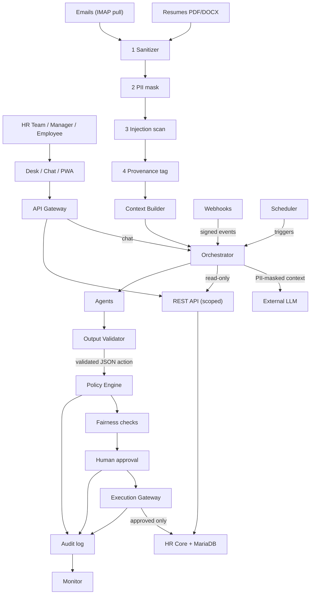

# HR AI MVP — Secure AI HR System

AI agents that take over daily HR-team work (resume screening and ranking, inbox digest, draft replies, follow-ups, interview scheduling, employee questions), built **on top of** an open-source HR platform used as the system of record (HR Core). Our code lives in our own app (`hr_ai`) and a separate agent service (`agents/`), never inside the platform itself.

**Golden rule: the agent executes, the human decides about people.** Nothing is sent or recorded without human approval.

Hackathon MVP (17 h, 5-minute demo). Fictional data only. The demo shows a prompt-injection attempt being blocked.

> Source of truth: [`CLAUDE.md`](CLAUDE.md). Details: [`docs/`](docs/).

## Architecture

Requests flow top to bottom: Users → Interfaces → **[trust boundary: authentication]** → Secure Integration Layer → Agentic AI Layer → **[trust boundary: enforcement]** → Guardrails & Execution Control → HR Core.

Resumes and emails come from an **Untrusted Input Zone** and reach the AI layer only through a fixed 4-stage pipeline (Sanitizer → PII mask → Injection scan → Provenance tag). The external LLM is untrusted and only ever sees PII-masked context. Agents can read HR Core through scoped read-only REST tokens, and their only output is structured JSON proposals. A deterministic validator checks those proposals, then a default-deny policy engine, fairness checks and a human approver. Only then does the **Execution Gateway**, the sole holder of write credentials, apply them. Every step is written to a hash-chained audit log.

## Component → folder map

| Component | Folder / file | Runs in |
|---|---|---|
| Webhooks, Scheduler hooks | `hr_ai/hr_ai/hooks.py`, `webhooks.py` | HR Core (in-process) |
| AI Action queue + `propose_action` | `hr_ai/hr_ai/ai_action/`, `api.py` | HR Core (in-process) |
| Policy Engine | `hr_ai/hr_ai/policy.py` | HR Core (in-process) |
| Fairness checks | `hr_ai/hr_ai/fairness.py` | HR Core (in-process) |
| Human approval | `hr_ai/hr_ai/approval.py` | HR Core (in-process) |
| Execution Gateway | `hr_ai/hr_ai/executor.py` | HR Core (in-process) |
| Audit Log / Monitor | `hr_ai/hr_ai/audit.py`, `monitor.py` | HR Core (in-process) |
| Mail ingestion + stages 1–4 | `agents/ingest/` | Agent service |
| Context Builder | `agents/context/` | Agent service |
| Orchestrator, budgets, LLM client | `agents/orchestrator/` | Agent service |
| Agents (Recruitment, Comms, Assistant, stubs) | `agents/agents/` | Agent service |
| Output Validator + schemas | `agents/validation/` | Agent service |
| Read-only REST client, tool allowlists | `agents/tools/` | Agent service |
| Signed webhook receiver | `agents/integration/` (assumed folder) | Agent service |
| API Gateway, Secrets Manager | TODO | TODO |
| Fictional data | `data/` | — |
| Guardrail tests | `tests/guardrails/` | — |

## Data flows

- **Inbound content:** CV/email → Sanitizer → PII mask → Injection scan (hit → quarantine + alert) → Provenance tag → Context Builder → Orchestrator. Raw originals are stored in HR Core.
- **User requests:** User → Desk/Chat/PWA → API Gateway → Orchestrator (chat) or scoped REST API → HR Core.
- **Triggers:** HR Core doc_events → HMAC-signed webhook → agent receiver (verify, dedupe, enqueue) → Orchestrator. Scheduler → Orchestrator (IMAP pull, reminders, digest).
- **Agent reads:** REST only, using a per-agent read-only service user. Agents never connect to MariaDB.
- **LLM calls:** Orchestrator → External LLM with PII-masked context. The trusted system prompt is kept separate from data, and responses are treated as untrusted.
- **Proposal path:** Agent → Output Validator → `propose_action` (AI Action = Proposed) → Policy Engine → Fairness → Human approval (token bound to `action_hash`) → Execution Gateway (verify, re-check policy, idempotent) → HR Core. Policy, approval and execution are audited.

## Security principles

- The agents have no write credentials. Only the Execution Gateway writes, and only for approved actions whose approval matches the action hash.
- Resumes, emails and tool outputs are **data**. They always pass stages 1–4 (even in tests) and are never put in the system prompt.
- PII is masked before any scoring or LLM call. Scoring uses job-related criteria only, with protected attributes blind and a disparity test.
- One candidate per context, per-agent tool allowlists, step/token budgets.
- The Output Validator is deterministic code, not an LLM.
- The Policy Engine is default-deny.
- Webhooks are HMAC-signed, replay-protected and idempotent.
- No secrets in prompts, logs or git. Use `.env`, which is gitignored; see `.env.example`.
- The Audit Log is append-only and hash-chained, and entries are never updated or deleted.
- Each guardrail has its own test: injection, bypass, disparity, duplicate webhook.

More: [`docs/security.md`](docs/security.md).

## How our code connects to HR Core

- **`hr_ai` (in-process):** a custom app running inside HR Core. It uses plain Python calls and hooks, with no network hop. `hooks.py` registers `doc_events` and `scheduler_events`, and whitelisted methods become `POST /api/method/hr_ai.api.<fn>`. The app must be built into the Docker image.
- **`agents/` (out-of-process):** REST only (`/api/resource/<DocType>`, `Authorization: token KEY:SECRET`), with one least-privilege service user per agent. Proposals are submitted via `propose_action`.
- **HR Core → agents:** a signed webhook (Webhook DocType or a hook). The receiver verifies the HMAC, rejects replays, dedupes on the key "doc name + event id", enqueues the event and returns fast.
- **UI:** Custom Fields, Workflows, Workspaces, Client Scripts and Desk pages from `hr_ai`. Upstream platform code is never patched.

Contracts: [`docs/contracts.md`](docs/contracts.md).

## Technology choices

| Item | Status |
|---|---|
| System of record | Open-source HR platform, v16 (Docker, kept outside this repo) |
| `hr_ai` language | Python |
| PII masking | Presidio (named in CLAUDE.md) |
| Agent service language/framework | TODO |
| LLM provider and model | TODO |
| Malware scanner | TODO |
| Injection classifier | TODO |
| Vector store (Q&A) | TODO |
| Secrets Manager | TODO |
| Approval-signing key management | TODO |
| Audit Log storage, Monitor alert channel | TODO |
| Calendar source | TODO (demo: JSON of free slots) |

## Current status

- **Done:** HR Core running in Docker. Architecture designed. Repository skeleton and docs created; every module file is a placeholder.
- **Not built:** `hr_ai` app, AI Action queue, webhooks, agent service, security pipeline, mail ingestion, fictional data, tests.
- **Next:** see [`docs/build-plan.md`](docs/build-plan.md).

## Open questions

Copied from CLAUDE.md §11, unresolved:

- Manager role: user rule is Desk view-only, but the diagram says "Manager / HR approves in Desk". Confirm.
- Outgoing replies need real names/emails but PII is masked: where does de-tokenization happen, and who may do it?
- Where are raw originals and the PII token map stored?
- Not chosen yet: agent service language/framework, LLM provider and model, malware scanner, injection classifier, vector store, Secrets Manager, approval-signing key management.
- Audit Log storage and Monitor alert channel unspecified. Calendar source for scheduling unspecified.
- Licensing: the upstream HR platform is GPL v3. Check implications of distributing the modified product.
