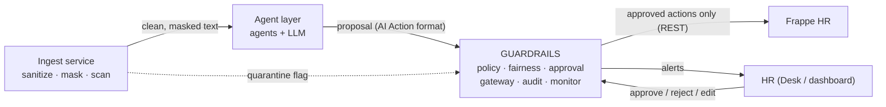

# Guardrails & Execution Control: integration guide

This guide is for the teams building the other layers: the **agent layer / `hr_ai`** (agents, AI Action
queue), the **ingest service** (sanitizer, PII masking, injection scanner) and the **HR interface**.
It explains what the guardrails layer does, how to call it, and what each layer must send.

All data in this guide is fictional.

---

## 1. Where this layer sits



- **Ingest** checks what goes **into** the AI ("is this document dangerous?").
- **Guardrails** check what comes **out of** the AI ("is this action allowed, for this person, and did a human approve it?").
- Both are needed: no injection scanner catches everything, so a fooled agent must still be unable to act.

**The rule this layer enforces:** agents only *propose*. Nothing is written to Frappe unless the policy
allows it, the fairness checks pass, an HR user approved **that exact version**, and the gateway re-checks
everything at execution time. Every step is written to a tamper-evident audit log.

---

## 2. Quick facts

| | |
|---|---|
| Service | FastAPI, folder `guardrails/`, default port **8100** |
| Start | `./venv/Scripts/python -m uvicorn guardrails.settings:create_app_from_env --factory --port 8100` |
| Docs (live) | `http://<host>:8100/docs` |
| Health | `GET /health` → `{"status": "ok"}` (no auth) |
| Auth | the caller's **own Frappe credentials**: `Authorization: token KEY:SECRET` |
| Identity & roles | asked to Frappe on every call (cached 60 s), never read from the request body |
| Frappe down | every call refused (fail closed) |
| Storage | SQLite file (`GUARDRAILS_DB_PATH`), actions + hash-chained audit log |
| Demo without Docker | `./venv/Scripts/python scripts/demo.py --start` |

> Port note: the ingest service also defaults to **8090**, the same port as `scripts/fake_frappe.py`.
> If both run on one machine, start the demo with `--frappe-port 8091`.

---

## 3. Agent layer / `hr_ai` (agents + AI Action queue)

### 3.1 What the guardrails accept

Send the proposal **exactly as the agent layer produces it** (the AI Action fields). JSON-string fields
(as stored in Frappe `Code` fields) are accepted too.

```json
{
  "kind": "email_reply",
  "agent": "comms",
  "subject": "email/010_candidate",
  "reference_doctype": null,
  "reference_name": null,
  "summary": "To: [EMAIL_1] Subject: Question about the Sales Representative position ...",
  "payload": {
    "email_id": "010_candidate",
    "to": "[EMAIL_1]",
    "subject": "Question about the Sales Representative position",
    "body": "Dear [PERSON_1],\n\nThank you for your interest ..."
  },
  "token_map": {"[PERSON_1]": "Cyrine Jlassi", "[EMAIL_1]": "cyrine.jlassi.sr2@example.com"},
  "source_hashes": ["bcee57a58f42ad9bbd3c92520295b83c546b241fb23109042b3f5957225869b5"],
  "action_hash": "84c22d32235fc7dc4ffe82e2b6bc11a3e9610ab9f59e3ae386fd508c4d48cacf",
  "external_id": "AIA-6ec528d223",
  "run_id": "c4ba4f109cb8"
}
```

| Field | Required | Notes |
|---|---|---|
| `kind`, `agent`, `external_id` | yes | `external_id` becomes the guardrails action id (`[A-Za-z0-9_.:-]`, max 64) |
| `payload` | yes | object or JSON string |
| `token_map` | if tokens are used | `{"[TOKEN_n]": "real value"}`; **never trusted on its own**, see 3.3 |
| `source_hashes` | yes | 64-hex SHA-256 (with or without `sha256:` prefix) |
| `reference_doctype`, `reference_name` | when the action targets a record | e.g. `Job Applicant` / `imen.baccouche.dm7@example.com` |
| `subject`, `summary`, `action_hash`, `run_id` | optional | stored or returned for traceability |
| anything else | refused (422) | e.g. an agent may not send `approver` or `status` |

Mapping from `hr_ai.api.propose_action` input: `id` → `external_id`, `token_values` → `token_map`.

### 3.2 Which kinds are supported today

| `kind` | Agent | Guardrails tool | Status |
|---|---|---|---|
| `email_reply` | comms | `send_email` | ✅ supported, including replies to `<SENDER>` (address read from the Inbound Email in Frappe, never from the proposal) |
| `interview` | recruitment | `schedule_interview` | ✅ supported (creates a Frappe HR `Interview`) |
| `ranking` | recruitment | `rank_shortlist` | ✅ supported: the whole list for one Job Opening; each entry needs a score 0-100 and a justification of 20+ characters, scanned for protected terms. Decision only (nothing written) |
| `applicant_status` | recruitment | `update_applicant_status` | ✅ supported: the payload's `applicant` must be the referenced Job Applicant |
| `digest` | comms | `inbox_digest` | ✅ supported. Decision only (nothing sent or written) |
| `leave_decision`, `review_summary`, `grievance_triage`, `onboarding_tasks`, `welcome_email`, `payroll_reply` | stub agents | none yet | ❌ denied by default (no policy entry) |
| any other | | | ❌ denied (default-deny) |

### 3.3 Security rules applied to agent output

The `token_map` is written by the agent layer, so a prompt-injected agent could put
`[EMAIL_1] = attacker@evil-mail.test` in it. An HR approver in Desk would still read `To: [EMAIL_1]`.
So the guardrails:

1. **Look up every email token in Frappe.** The address must belong to exactly one Job Applicant or
   Employee, which becomes the recipient **record**. Unknown or ambiguous → `recipient_unknown` (blocked).
2. **Check every token value against that person's Frappe record** (name, first name, email).
   `[PERSON_1] = "confirm your bank details at http://..."` → `token_value_not_from_record` (blocked).
3. **Re-check at send time.** The gateway reads the address from Frappe again and de-tokenizes the email
   only with values that still match the record.
4. **Interviews:** `token_map[applicant]` must equal `reference_name` → else `subject_mismatch`.
5. **Each Frappe account is bound to one agent.** `agent.comms@rhflow.local` proposing as `recruitment`
   → `403 agent_impersonation` + critical alert.

### 3.4 Option A (recommended, **implemented**): `hr_ai` asks the guardrails before acting

Implemented in `hr_ai/hr_ai/guardrails_client.py`, called from `api.propose_action` and `executor._check`.
Site config: `hr_ai_guardrails_url`, `hr_ai_guardrails_api_key`, `hr_ai_guardrails_api_secret`
(setup in `docs/manual-test.md`). End-to-end test: `tests/test_hr_ai_bridge.py`. The sketch below was the proposal.

Smallest change to working code. `hr_ai` keeps its queue, Desk page and executor, and calls the
guardrails at the two moments that matter. This fills the TODO at the top of `hr_ai/executor.py`
("policy re-check (default-deny), fairness, hr_ai audit log, monitor alerts").

```python
# hr_ai/guardrails_client.py  (suggested)
import frappe, requests

def check_with_guardrails(doc_or_dict) -> dict:
    """Dry run in the guardrails. Raises if not allowed. Fail closed on any error."""
    conf = frappe.conf  # site_config.json: guardrails_url, guardrails_api_key, guardrails_api_secret
    d = doc_or_dict if isinstance(doc_or_dict, dict) else doc_or_dict.as_dict()
    body = {k: d.get(k) for k in ("kind", "agent", "subject", "reference_doctype", "reference_name",
                                   "summary", "payload", "source_hashes", "token_map", "action_hash",
                                   "external_id", "run_id") if d.get(k) not in (None, "")}
    # external_id is required by the guardrails; agents may omit "id" in propose_action
    body.setdefault("external_id", d.get("name") or f"AIA-{frappe.generate_hash(length=10)}")
    try:
        r = requests.post(f"{conf.guardrails_url}/agent-actions/check", json=body, timeout=10,
                          headers={"Authorization": f"token {conf.guardrails_api_key}:{conf.guardrails_api_secret}"})
        r.raise_for_status()
        verdict = r.json()
    except Exception:
        frappe.throw("Guardrails unavailable: action refused (fail closed)")
    if not verdict["allowed"]:
        frappe.throw("Blocked by guardrails: " + "; ".join(v["rule"] for v in verdict["violations"]))
    return verdict
```

Where to call it:

| In `hr_ai` | When | Effect |
|---|---|---|
| `api.propose_action`, after building the doc, before `doc.insert()` | proposal arrives | blocked proposals never reach the HR queue |
| `executor.execute`, after `_check(doc)`, before `handler(...)` | right before writing | re-check: rules or records may have changed since approval |

The account in `guardrails_api_key` must be an **HR-role** Frappe user (`/agent-actions/check` accepts
agent accounts or HR). It must not have an agent role.

### 3.5 Option B: the guardrails own the queue

Agents send proposals to `POST /agent-actions` instead of `hr_ai.api.propose_action`. The guardrails
store them, HR approves through the guardrails API, and the guardrails gateway writes to Frappe.
Cleaner separation, but it duplicates the `hr_ai` queue and Desk page, so it is a bigger change.

### 3.6 Accounts and roles (already configured)

| Frappe user | Role | Mapped agent |
|---|---|---|
| `agent.recruitment@rhflow.local` | RH Flow Agent Recruitment | `recruitment_agent` |
| `agent.comms@rhflow.local` | RH Flow Agent Comms | `comms_agent` |
| `agent.assistant@rhflow.local` | RH Flow Agent Assistant | `hr_assistant` |
| `agent.onboarding / leave / payroll / performance / conflict@rhflow.local` | RH Flow Agent … | stubs (no tools) |
| `agent.orchestrator@rhflow.local` | RH Flow Agent Orchestrator | not mapped → denied |

All `RH Flow Agent …` roles are registered as **agent roles**: these accounts can never approve,
reject, edit or execute. Files: `config/api.json`, `config/approval.json`, `config/agent_layer.json`.

---

## 4. Ingest service (sanitizer, PII, injection scanner)

### 4.1 Report quarantined documents

When the scanner marks a document `suspicious` or `quarantined`, report it so HR gets an alert
in the same feed as everything else:

```http
POST /input-flags
Authorization: token <ingest service key>:<secret>
Content-Type: application/json

{
  "source_hash": "sha256:d4aca7c854dd50849ad067307ea83512b9506300fbfed5e67e2bc47be6b5f9c2",
  "detector": "rules",
  "rules": ["ignore_previous_instructions", "white_text"],
  "candidate": "HR-APP-0042"
}
```

- `source_hash`: use **the same hash the agents put in `source_hashes`**. That way an alert on a
  blocked proposal and the quarantine flag point at the same document.
- Caller: the Frappe user listed in `config/api.json` → `ingest_accounts` (create one, e.g.
  `svc.ingest@…`, and add it there).
- Response `201`: `{"audit_seq": 42}`. The monitor raises a `suspected_injection` alert.

### 4.2 Token resolution (to decide as a team)

The ingest service exposes `POST /v1/resolve {doc_id, token}` (key `RESOLVER_API_KEY`, "Execution Gateway
only"). Resolving tokens through **the service that created them** is more trustworthy than the
agent-supplied `token_map`. Today the guardrails verify tokens against Frappe records instead (3.3).

Open points:
- **Two token formats:** ingest uses `<PERSON_1>`, the agent layer uses `[PERSON_1]`.
- **Two masking pipelines:** `input-security-layer/` and `agents/ingest/`. Pick one.
- Once decided, the gateway can call `/v1/resolve` with the proposal's source `doc_id` instead of
  trusting `token_map`.

---

## 5. HR interface (Desk page or dashboard)

Call from your **backend**, never from the browser (keys stay server-side). Render every text field
as **plain text** (proposals can contain hostile text on purpose).

| Endpoint | Purpose |
|---|---|
| `GET /actions?status=Proposed` | review queue |
| `GET /actions/{id}` | details + audit trail of one action (never the approval token) |
| `POST /actions/{id}/approve` `{"seen_hash": "sha256:…"}` | approve **the version shown** → returns `approval_token` |
| `POST /actions/{id}/reject` `{"reason": "…"}` | reject (reason required) |
| `PUT /actions/{id}/payload` `{"payload": {…}}` | edit: voids the approval, re-runs all checks |
| `POST /actions/{id}/execute` `{"token": "…"}` | execution gateway |
| `GET /alerts?open_only=true&min_severity=high` | monitor alerts |
| `POST /alerts/{id}/ack` `{"note": "…"}` | acknowledge an alert |
| `GET /audit?action_id=…`, `GET /audit/verify` | audit trail, chain integrity check |
| `POST /fairness/disparity` | four-fifths test on a screening batch |

Approve flow: show the action **and its `action_hash`** → send that hash with the approval → if the action
changed meanwhile, you get `409 stale_hash` and must reload.

With option A (3.4), HR keeps approving in the `hr_ai` Desk page; the dashboard can still show
`/alerts` and `/audit/verify`.

---

## 6. Frappe setup the guardrails need

| What | Why |
|---|---|
| A gateway user (e.g. `guardrails.gateway@…`) with an API key, roles allowing the writes below | the **only** writer: Communication (email), Job Applicant (`applicant_rating`, `status`), Comment, Interview |
| The gateway user also needs **HR Manager** read on Inbound Email | to read the HR-only sender of a `<SENDER>` reply (section 3.2) |
| An HR Manager API user for `hr_ai` (not an agent) | `hr_ai` calls `/agent-actions/check` with it (section 3.4) |
| HR users with **HR Manager** | approvers |
| One user per agent with its agent role | proposers (already exist: `agent.*@rhflow.local`) |
| An ingest user listed in `ingest_accounts` | `POST /input-flags` |
| An outgoing **Email Account** | otherwise every email fails with `OutgoingEmailError` (seen on the team Frappe) |

Environment (`guardrails/.env`, gitignored; template in `example.env`):

```
GUARDRAILS_APPROVAL_KEY=<python -c "import secrets; print(secrets.token_urlsafe(48))">
GUARDRAILS_DB_PATH=data/guardrails.db
FRAPPE_URL=http://<frappe-host>:<port>
FRAPPE_GATEWAY_API_KEY=...
FRAPPE_GATEWAY_API_SECRET=...
```

---

## 7. Responses and error codes

Submitting (`POST /agent-actions`) always records the proposal: `201` with `"status": "Proposed"` or
`"Blocked"` plus `violations[]`. Dry run (`POST /agent-actions/check`) returns `"allowed": true|false`.

| Rule code | Meaning |
|---|---|
| `unknown_agent`, `tool_not_allowed`, `unknown_tool` | default-deny: agent or kind not allowed |
| `recipient_unknown` | email address not a known applicant/employee in Frappe |
| `token_value_not_from_record` | a token value does not match the person's Frappe record |
| `unresolved_token` | a token used in the payload is missing from `token_map` |
| `subject_mismatch` | the action targets another person than its reference |
| `recipient_not_a_record`, `recipient_not_subject`, `too_many_recipients` | recipient rules |
| `rate_limit` | too many actions of this kind in the window |
| `protected_attribute`, `protected_term_in_text` | fairness: age, gender, origin… in data or justification |
| `justification_missing / too_short / unsourced`, `criterion_not_job_related` | fairness: scores must be justified, sourced, job-related |
| `bad_source_hash`, `agent_output_malformed` | malformed proposal |
| `directory_unavailable` | Frappe unreachable during checks (fail closed) |

| HTTP | Meaning |
|---|---|
| `401` | no or bad Frappe credentials |
| `403` | wrong role, `agent_impersonation`, `forbidden_endpoint`, bad/expired token |
| `409` | `stale_hash`, `invalid_state`, `duplicate_action`, `in_progress` |
| `413` / `422` | body too large / malformed input |
| `429` | rate limited |
| `503` | Frappe unavailable (fail closed) |

---

## 8. Open items

| # | Item | Owner |
|---|---|---|
| 1 | ~~Choose option A or B~~: option A, implemented (3.4) | done |
| 2 | ~~Adapter support for `ranking` and `applicant_status`~~ | done |
| 3 | ~~Policy entry for `digest`~~ done; stub kinds (`leave_decision`, …) stay denied until their agents exist | guardrails + agent layer |
| 4 | One token format and one masking pipeline; use `/v1/resolve` in the gateway | team |
| 5 | Outgoing Email Account on Frappe (test recipient mode exists in `hr_ai`) | Frappe owner |
| 6 | AI Actions `AIA-2026-00001` / `00003` have no `token_map`: old pipeline or bug? | agent layer |
| 7 | Push `hr_ai` / `agents` code and merge branches into `main` via PRs | everyone |

Questions about this layer: see `guardrails/README.md`, or run the demo (`scripts/demo.py --start --step`).
